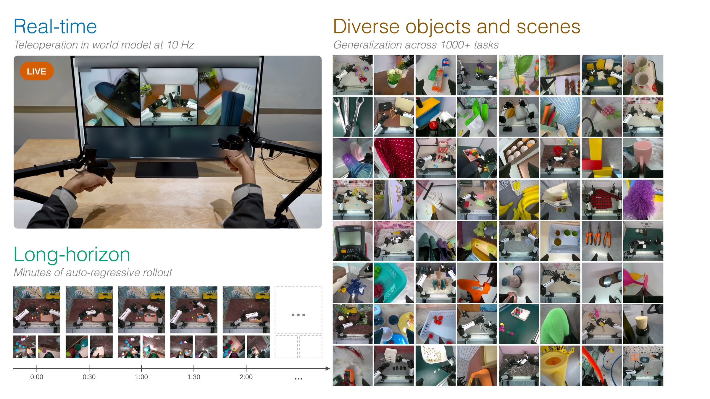

<div align="center">

# DreamFAR: Real-Time and Long-Horizon Interaction with Diverse Objects

[Yiming Dou](https://www.yimingdou.com/)<sup>1,2</sup>,
[Botao He](https://bottle101.github.io/)<sup>1,3</sup>,
[Antonio Loquercio](https://antonilo.github.io/)<sup>4</sup>,
[Andrew Owens](https://andrewowens.com/)<sup>2</sup>,
[Jitendra Malik](https://people.eecs.berkeley.edu/~malik/)<sup>1</sup>,
[Sumedh Anand Sontakke](https://sumedh7.github.io/)<sup>1</sup>,
[Ruoshi Liu](https://ruoshiliu.github.io/)<sup>1,3</sup>

<sup>1</sup>Amazon FAR &nbsp; <sup>2</sup>Cornell University &nbsp; <sup>3</sup>University of Maryland, College Park &nbsp; <sup>4</sup>University of Pennsylvania

[](https://amazon-far.github.io/dreamfar/assets/paper/DreamFAR.pdf)
[](https://amazon-far.github.io/dreamfar/)
[](https://github.com/amazon-far/dreamfar)
[](LICENSE)



</div>

DreamFAR is an action-conditioned world model trained from scratch on ~20k hours of real bimanual
teleoperation (XDOF, 3 cameras, 10 Hz). It predicts the next frames of all three views from the robot's
commanded end-effector actions in real time, keeps a **contact-keyframe memory** of the episode so objects
stay consistent over minutes, and streams with a KV-cached diffusion-forcing pyramid at 10 Hz on one GPU.

The release has two stages:

1. **Image tokenizer** (`dreamfar/tokenizer`): a 256x256 image -> 16x16x16 unit-sphere latent. SSDD-style
   f16 encoder + U-ViT flow-matching decoder, trained with flow matching + LPIPS + REPA + a latent-uniformity term.
2. **Dynamics model** (`dreamfar/dynamics`): a 2.2B-parameter DiT over the view-stacked latents of a
   50-frame streaming window `[sink | memory | context]`, trained with iid diffusion forcing, a denoised
   state token, a detached contact head, multi-chunk-prediction heads and contact-weighted loss.
   Inference = 16-step pyramid, one committed frame per step, un-roped KV cache for sink/memory/context.

Everything here is a pruned copy of the research code that produced the paper's checkpoints: the released
code is bit-identical to it (see [Tests](#tests)). The tokenizer's encoder, decoder and flow-matching
components come from the external [facebook/SSDD](https://github.com/facebookresearch/SSDD) package (installed
separately at a pinned commit, under its own CC BY-NC 4.0 license; see [License](#license)).

---

## Installation

Requires Python >= 3.11 (SSDD's requirement). Tested with Python 3.11, PyTorch 2.7.1 + CUDA 12.6 on one node with 8x A100-40GB and one node with 8x H200 (every
command marked [smoke-tested] below was run from a fresh clone of this repository and a fresh virtual environment).

```bash
git clone https://github.com/amazon-far/dreamfar.git && cd dreamfar
python3.11 -m venv .venv && source .venv/bin/activate         # or: uv venv --python 3.11 .venv
pip install torch==2.7.1 torchvision==0.22.1 --index-url https://download.pytorch.org/whl/cu126   # or cu128
pip install -r requirements.txt
bash scripts/install_ssdd.sh          # facebook/SSDD at the pinned commit, editable, into third_party/SSDD
pip install -e .
```

SSDD is not on PyPI and its `pyproject.toml` packages only the top-level module, so `scripts/install_ssdd.sh`
clones it at commit `c8542960d69107535aeb1b673676786a1544c5cf` and installs the clone in editable mode.

Optional, for tokenizer training only (REPA teacher): the [LingBot-Vision](https://github.com/robbyant/lingbot-vision)
package and its `small` backbone weights (`algorithm.repa.lingbot_weights_dir`); set `algorithm.repa=null` to train
without REPA.

Run everything from the repository root (`python -m dreamfar...`); outputs go to `outputs/`.

## Model zoo

| Model | Config | Checkpoint | Size | Notes |
|---|---|---|---|---|
| Tokenizer `tok256` (step 200k) | [`configs/release/tok256_ssdd_final_v1.yaml`](configs/release/tok256_ssdd_final_v1.yaml) | `CHECKPOINT-URL/tok256_step000200000.ckpt` (1.16 GB) | 46M enc + 50M dec | 256x256 -> 16x16x16 unit-sphere latent; averaged (ScheduleFree) weights |
| Dynamics `v9` (step 54k) | [`configs/release/dreamfar_v9.yaml`](configs/release/dreamfar_v9.yaml) | `CHECKPOINT-URL/dreamfar_v9_step000054000.ckpt` (4.4 GB) | 2.19B trained, 1.93B deployed | EMA weights, bf16; MCP heads dropped at inference |
| Action/state normalizer | - | `CHECKPOINT-URL/spec_ee_joint_normalizer.pt` | - | spec-derived (`dreamfar.data.spec_normalizer`); also baked into the dynamics checkpoint |

The dynamics checkpoint loads with no key remapping (`dreamfar.inference.build.build_model` checks the exact
tensor name/shape set). The `dreamfar_v9.yaml` paths (`tokenizer_ckpt`, `tokenizer_config`, `ee_urdf_path`,
`dataset.*`) are placeholders: pass the real ones on the command line (shown below).

You also need the **YAM robot URDF** (`yam.urdf`, from the robot vendor's description package) for the
end-effector forward kinematics used by memory retrieval, the demo and the latent precompute.

## Data preparation

### Raw episodes

```
<raw_root>/index.json                          {"fps": 30, "episodes": [{"id": "<episode_id>", "task_name": "...", "size": <n_frames>}, ...]}
<raw_root>/<episode_id>/top.mp4                 `size` frames, time-aligned across views (any resolution; letterboxed to 256x256)
<raw_root>/<episode_id>/left.mp4
<raw_root>/<episode_id>/right.mp4
<raw_root>/<episode_id>/states_actions.bin      float64, C-order, shape (size, 28): [:, :14] joint state, [:, 14:] joint action
                                                YAM layout per 14: [L_j1..L_j6, L_grip, R_j1..R_j6, R_grip]; grippers in [0,1] (1 = open)
```

Row `k` of `states_actions.bin` is the state at frame `k` and the position target commanded at frame `k` (30 Hz).

### Contact labels (per episode, optional for inference, required for dynamics training)

`<contact_dir>/<episode_id>.json` (non-alphanumeric characters of the id replaced by `_`):

```json
{"frames": [0, 3, 6, ...],                       // native frame indices labeled (10 Hz grid)
 "contact": {"left": [0, 0, 1, ...], "right": [0, 1, 1, ...]},   // per-arm contact bit per labeled frame
 "keyframes": [87, 213, ...]}                    // native frames where either arm's contact flips
```

The paper's labels came from a fine-tuned vision-language contact labeler that is not part of this release;
any labeler producing this format works (`dreamfar/data/contact.py` turns it into per-frame bits + keyframes).

### Held-out split and normalizer

* `heldout.json`: `{"asset_ids": ["<episode_id>", ...]}`, the validation episodes (everything else trains).
* Normalizer: `python -m dreamfar.data.spec_normalizer --urdf yam.urdf --out normalizer.pt` (bounds from the
  URDF joint limits + the FK-reachable workspace; the released one is in the model zoo).

### Latent precompute (frozen tokenizer -> latent shards)  [smoke-tested]

```bash
python -m dreamfar.data.precompute_latents --raw-root <raw_root> --out <latent_root> \
    --tokenizer-ckpt tok256_step000200000.ckpt --tokenizer-config configs/release/tok256_ssdd_final_v1.yaml \
    --urdf yam.urdf --shard-episodes 512 --device cuda:0
```

Several processes can split the shards (`--shard-index i --num-shards n`). Output per shard:

```
<latent_root>/shard_XXX/latents.bin            float16 (N, 3, 16, 16, 16): view-stacked unit-sphere latents (top, left, right)
<latent_root>/shard_XXX/states_actions.bin     float32 (N, 28) joint state | action
<latent_root>/shard_XXX/states_actions_ee.bin  float32 (N, 40) end-effector state | action: [L_pos(3) L_rot6d(6) L_grip R_pos(3) R_rot6d(6) R_grip] x2
<latent_root>/shard_XXX/index.json             {"views", "latent_shape", "latent_dtype", "fps", "resolution", "episodes": [{"asset_id","start","size","task_name"}]}
```

## Training

All launchers are `torchrun` wrappers; every extra argument is a Hydra override (configs under `configs/`).
Single node = the commands below; multi-node = the same command on every node with
`NUM_NODES=<n> NODE_RANK=<r> MASTER_ADDR=<rank-0 ip> MASTER_PORT=29500` (not smoke-tested beyond 1 node).
A run is named with `name=<run>`; checkpoints go to `outputs/checkpoints/<run>/` (`last.ckpt` + the latest
step) and **relaunching the same command auto-resumes** from `last.ckpt` (`resume=scratch` to ignore it,
`resume=<path>` to pick a file). Logging: `wandb.mode=online wandb.project=... wandb.entity=...`.

### Tokenizer  [smoke-tested: 8xA100, 50 steps]

```bash
GPUS=8 bash scripts/train_tokenizer.sh name=tok256 \
    dataset.raw_root=<raw_root> dataset.heldout_path=<heldout.json> \
    algorithm.encoder_checkpoint=<F16C16_M_256.safetensors> algorithm.decoder_checkpoint=<F16C16_M_256.safetensors> \
    algorithm.repa.lingbot_weights_dir=<lingbot small weights>
```

The released run: 112 H200, per-GPU batch 48 (global 5,376), 200k steps, RAdamScheduleFree (1e-4 new params / 1e-5
pretrained), bf16-mixed, grad clip 0.5, losses `diffusion 1 + lpips 0.25 + repa 0.1 (10k-step warm-up) + uniformity 0.1`,
random view + horizontal flip, SSDD `F16C16_M_256` init ([facebook/SSDD](https://github.com/facebookresearch/SSDD)).
The smoke test ran exactly this launcher with `algorithm.repa=null` (no teacher weights on the box), random init,
`experiment.training.max_steps=50 experiment.training.batch_size=8`.

### Dynamics  [smoke-tested: full-size DiT on 8xH200 (20 steps + resume), reduced DiT on 8xA100-40GB (see below)]

```bash
GPUS=8 bash scripts/train_dynamics.sh name=dreamfar_v9 \
    dataset.latent_root=<latent_root> dataset.contact_dir=<contact_dir> dataset.heldout_path=<heldout.json> \
    dataset.normalizer_path=<normalizer.pt> \
    algorithm.tokenizer_ckpt=tok256_step000200000.ckpt algorithm.tokenizer_config=configs/release/tok256_ssdd_final_v1.yaml \
    algorithm.ee_urdf_path=yam.urdf
```

Defaults (`configs/algorithm/dynamics.yaml`, `configs/experiment/dynamics.yaml`) are the released recipe:
DiT 2048 wide / 28 deep / 16 heads x 128, patch 2, joint spatio-temporal attention at layers [3, 9, 15, 21, 27],
window 50 frames at 10 Hz, memory 8 slots from a pool of 30 contact keyframes, MCP depth 3, AdamW lr 1e-3
(1k warm-up, wd 0.01 on matrices only, eps 1e-10), EMA 0.999, bf16-mixed, grad clip 0.5, per-GPU batch 8.
The released run used 256 GPUs (global batch 2048) warm-started from an earlier run
(`algorithm.init_dynamics_ckpt=<ckpt>`, weights only). The full-size smoke test (8x H200, random init) ran the command
above with `experiment.training.batch_size=2 experiment.training.max_steps=20` (about 8 min including compilation;
a full checkpoint with optimizer + EMA state is 35 GB); the A100-40GB smoke test used
`algorithm.dit.dim=1024 algorithm.dit.depth=12 algorithm.dit.attn_heads=8 algorithm.dit.full_attn_layers=[3,7,11]
experiment.training.batch_size=2`. Resume was tested on both by relaunching the same command with a larger
`experiment.training.max_steps`.

In-training validation logs the teacher-forced flow loss per noise bucket and, on a few batches, the latent MSE /
cosine of a cold-start streaming rollout.

## Inference

### Rollout on a held-out episode  [smoke-tested]

```bash
python -m dreamfar.inference.rollout --ckpt dreamfar_v9_step000054000.ckpt --config configs/release/dreamfar_v9.yaml \
    --tokenizer-ckpt tok256_step000200000.ckpt --tokenizer-config configs/release/tok256_ssdd_final_v1.yaml --urdf yam.urdf \
    --latent-root <latent_root> --contact-dir <contact_dir> --episode 0 --regime mid --frames 300 --out outputs/rollouts
```

Seeds the first 10 s of the episode (`--regime mid`; `cold` / `dup` = cold starts from frame 0), rolls the
remaining frames out with the paper's streaming settings (P = 16 Euler steps per frame, logit-normal flow-time grid,
committed-context flow-time 0.2404, memory 0.1, bf16 weights), decodes GT and prediction with one fixed decoder
noise, and writes `<out>/<asset>_<regime>.mp4` (`[prediction | ground truth]`, views stacked) plus a JSON with
PSNR / SSIM / LPIPS per view over the predicted frames and the achieved fps. `--config` accepts the model-zoo
config or a training run's `.hydra/config.yaml`.

### Programmatic use

```python
from dreamfar.inference.build import build_model, decode_noise, decode_frame
from dreamfar.inference.episodes import list_episodes, load_episode
from dreamfar.inference.seeding import build_regime

model = build_model("dreamfar_v9_step000054000.ckpt", "configs/release/dreamfar_v9.yaml", "cuda:0",
                    overrides={"dyn_flow_steps": 16, "infer_t_schedule": "logit_normal", "stream_ctx_noise": 0.2404252730845196,
                               "infer_weights_dtype": "bf16", "tokenizer_ckpt": ..., "tokenizer_config": ..., "ee_urdf_path": ...})
eps, meta = list_episodes("<latent_root>")
batch = load_episode(model, eps[0], meta, "cuda:0", cap=300, contact_dir="<contact_dir>")
z_gt = model.stack_views(batch["latent"]).transpose(0, 1)                     # (1, T, C, 3*16, 16)
kw = build_regime("mid", model, z_gt, model.cond_action(batch["action"]), batch["state"], batch["frame_idx"],
                  contact=batch.get("contact"), seed_sec=10, fps=10)
z_pred, _ = model.rollout(kw["z_hist"], kw["action"], kw["state"], kw["frame_idx"],
                          seed_latents=kw["seed_latents"], seed_contact=kw["seed_contact"], compiled=True)
rgb = decode_frame(model.tokenizer, z_pred[0, -1:], 3, decode_noise(model, "cuda:0"), steps=2)   # (3, 3, 256, 256) in [0,1]
```

`model.rollout` also drives the interactive demo: with `pending_fn` / `on_admit` / `wait_fn` / `on_commit` it admits a
frame only when an action is available, idles with the KV cache frozen, and hands every committed latent off as
soon as it exists.

## Demo  [smoke-tested headless]

A single-page web demo (keyboard and mouse control of the two arms; `dreamfar/demo/`):

```bash
export DEMO_CKPT=dreamfar_v9_step000054000.ckpt DEMO_CONFIG=configs/release/dreamfar_v9.yaml \
       TOKENIZER_CKPT=tok256_step000200000.ckpt TOKENIZER_CONFIG=configs/release/tok256_ssdd_final_v1.yaml \
       URDF_PATH=yam.urdf LATENT_ROOT=<latent_root> CONTACT_DIR=<contact_dir> HELDOUT_PATH=<heldout.json>
CUDA_VISIBLE_DEVICES=0 python -m uvicorn dreamfar.demo.server:app --host 127.0.0.1 --port 8000 \
    --ws-max-size 33554432 --ws-per-message-deflate false
```

Open http://localhost:8000 (tunnel the port from a remote machine). Start-up builds the model and compiles
+ warms the decoder and the dynamics (a few minutes). With two visible GPUs the decoder runs on the second one.
Keyboard: W/S A/D Q/E move the left end-effector, 1/Z 2/X 3/C rotate it, R/F open/close its gripper; I/K J/L U/O,
7/M 8/, 9/., P/; for the right arm. Mouse: left/right click picks an arm, the pointer over the top view sets its
table position, the wheel its height, Space toggles its gripper. Headless check (connects, holds keys, saves
frames): `python -m dreamfar.demo.ws_client --url ws://127.0.0.1:8000/ws --seconds 8 --out outputs/demo_check`.
Hand-tracking and leader-arm input modes of the paper's demo need extra hardware / trackers and are not included.
All environment-variable knobs and the websocket protocol: [`dreamfar/demo/README.md`](dreamfar/demo/README.md).

## Repository structure

```
configs/                    Hydra configs: config.yaml, algorithm/{tokenizer,dynamics}.yaml, dataset/{frames,latents}.yaml,
                            experiment/{tokenizer,dynamics}.yaml, release/ (model-zoo configs)
dreamfar/tokenizer/         net.py (SsddTokenizer: encode / decode), encoder.py, decoder.py (thin wrappers over SSDD's encoder
                            and U-ViT decoder), losses.py (LPIPS, REPA), module.py (Lightning training), data.py (frame dataset)
dreamfar/dynamics/          dit.py (streaming DiT: training forward, stream_prefill / stream_decode KV cache), attention.py,
                            stream_layout.py (masks, dt-RoPE), mcp.py, module.py (loss, EMA, validation, KV-cached rollout), optim.py
dreamfar/data/              latent_dataset.py (shards, windows, contact-keyframe memory selection), contact.py, video.py (PyAV),
                            precompute_latents.py, ee_fk.py (URDF forward kinematics), rot6d.py, normalizer.py, spec_normalizer.py
dreamfar/inference/         build.py (checkpoint -> model, decode helpers), episodes.py, seeding.py (cold / dup / mid), rollout.py
dreamfar/train/             experiment.py (data + Trainer wiring), train.py (Hydra entrypoint), dump_config.py
dreamfar/demo/              server.py (FastAPI / websocket), index.html, modes.py, ik.py, ws_client.py, README.md
scripts/                    train_tokenizer.sh, train_dynamics.sh (torchrun launchers), install_ssdd.sh
tests/                      test_equivalence.py (bit-exactness against the original code's reference dump)
```

## Tests

`tests/test_equivalence.py` compares the release against reference tensors dumped from the original research code
(same checkpoints, same seeds, fp32 eager on one GPU): tokenizer encode / decode (fp32 and bf16) and training loss,
the dynamics state_dict name/shape set, one streaming loss evaluation (flow, state, 3 MCP terms, contact BCE), the
data loader's episode batch and a 120-frame mid-start rollout (eager and torch.compiled, memory selections and
keyframe bank included). All comparisons are `torch.equal` (run with SSDD installed at the pinned commit above).
The reference dump is not distributed.

## Citation

```bibtex
@article{dreamfar2026,
  title   = {DreamFAR: TITLE},
  author  = {AUTHORS},
  journal = {arXiv preprint arXiv:PAPER-ID},
  year    = {2026}
}
```

## License

The code in this repository is licensed under the Apache License 2.0 (see [LICENSE](LICENSE) and [NOTICE](NOTICE)).
It depends on third-party packages under their own licenses. In particular, the tokenizer requires
[facebook/SSDD](https://github.com/facebookresearch/SSDD), which is **not** included here and is licensed under
**CC BY-NC 4.0** (non-commercial), as are the SSDD `F16C16_M_256` weights the tokenizer was initialized from. See
[THIRD_PARTY.md](THIRD_PARTY.md) for all third-party components.

## Acknowledgements

The tokenizer builds on [SSDD](https://github.com/facebookresearch/SSDD) (its encoder, U-ViT decoder and flow-matching
code are used as a dependency, and its pretrained weights as the initialization) and uses [LingBot-Vision](https://github.com/robbyant/lingbot-vision) as the REPA
teacher; the multi-chunk-prediction heads follow *Next Forcing*; the memory and streaming design draws on
Diffusion Forcing, WorldMem, LongLive and WEAVER; the project started from the
[Interactive World Simulator](https://github.com/WangYixuan12/interactive_world_sim) codebase.
